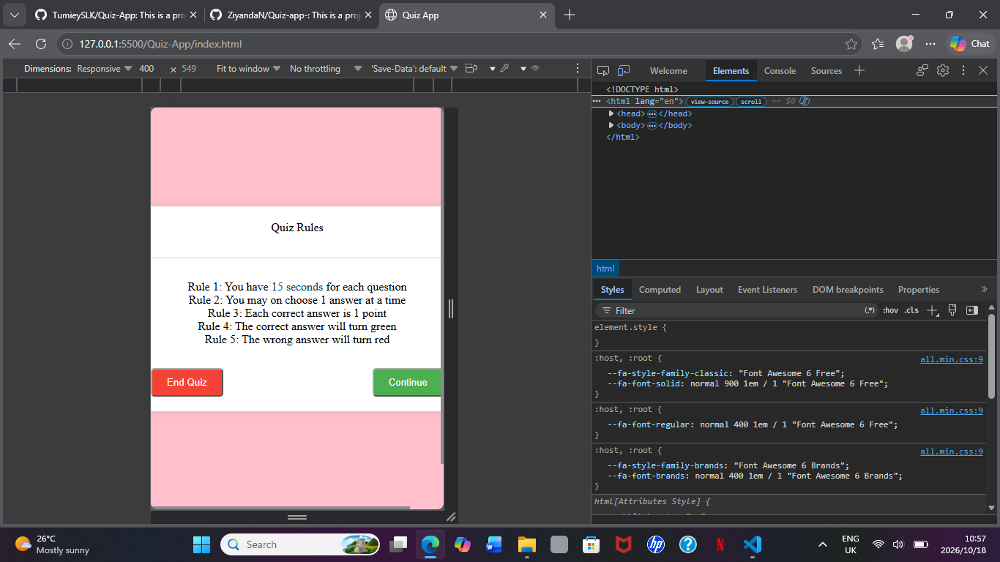

# Music Quiz

Music Quiz is an interactive, mobile-friendly quiz application that tests users' knowledge of music. It features five multiple-choice questions, a 15-second countdown timer for each question, score tracking, and a results screen showing the final score and percentage.

Live demo: https://timely-liger-9235a3.netlify.app/

## Features

- Select the Music quiz from the home screen
- Answer five multiple-choice questions
- Choose from four answer options per question
- Use a 15-second countdown timer for each question
- Receive visual feedback for correct and incorrect answers
- Track the current score and question number
- View the final score and percentage
- Review selected answers and correct answers

## Tech Stack

- Language(s): HTML, CSS, JavaScript
- Programming approach: Object-Oriented Programming (OOP)
- Database: Not applicable

## Installation

1. Clone the repository:

   [https://github.com/TumieySLK/Quiz-App.git]

2. Open the project folder.

3. Make sure `index.html`, `style.css`, and `script.js` are in the same folder.

4. Open `index.html` in your web browser, or use the Live Server extension in Visual Studio Code.

## Usage

1. Open the application.
2. Click Start Quiz to begin.
3. Read the question displayed on the screen.
4. Select one of the four answer options.
5. Answer within 15 seconds before the timer runs out.
6. Click Next Question to continue.
7. Repeat until all five questions have been answered.
8. View your final score and percentage.
9. Click Try Again to restart the quiz.

## Known Issues and Next Steps

- The application currently includes only one quiz topic: Music.
- The quiz contains five questions.
- A future version could include additional quiz topics, difficulty levels, and a high-score leaderboard.
- A future version could save high scores in the browser.

## Author

Ziyanda Ndaba | GitHub: @ ZiyandaN | Frontend
Tumiso Seleka | GitHub: @TumieySLK | Frondend

## Licence and Credits

Licensed under the MIT Licence.

Credits: No external frameworks or libraries are currently required.
